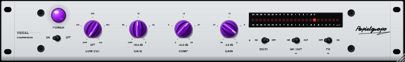

# PAPIELGUAPO - VOCAL Compressor 2.3.0

Compresor vocal independiente VST3 y aplicación para Windows x64. Skin metálica y perillas moradas del FET, con el nombre **VOCAL Compressor** en el panel.



[Descargar Windows x64](https://github.com/papielguapo/papielguapo-vocal-compressor/releases/tag/v2.3.0)

## Coloración progresiva 2.3

Sin nuevas perillas: al bajar Comp aumenta progresivamente la aportación del **segundo y tercer armónico**, combinando la posición del control con la reducción real. El nivel de la señal también influye en la coloración. Con Comp en 0 no se añade coloración intencional.

La etapa usa términos cuadrático/cúbico, sobremuestreo **8×** y un Butterworth de **24 dB/oct a 20 Hz** sobre la corrección para retirar continua. La señal lineal principal no pasa por ese filtro. Se suaviza la modulación periódica de la ganancia y se reserva progresivamente hasta 3 dB de margen. No es una garantía de ausencia de clipping para cualquier señal ni un limitador true peak; FIX puede compensar ese margen al igualar RMS.

**Latencia a 48 kHz: 897 muestras, 18,69 ms**, declarada al DAW y aplicada también al bypass y a Delta. Es mayor que antes y puede notarse en monitorización de grabación. No se añaden controles EVEN/ODD: la cantidad es automática.

En una senoide de 74 Hz, entrada pico 0 dBFS y Comp -24: H2 ≈ -36,7 dBc, H3 ≈ -46,6 dBc; H4–H10 quedan por debajo de -86 dBc en ese caso. No se afirma exclusividad matemática para cualquier señal o sobrecarga. En una prueba concreta de dos tonos, la suma de seis bandas laterales bajó unos 6,7 dB frente a 2.2; sigue existiendo IMD.

[Mediciones y condiciones completas](Validation/Harmonics-2.3/Informe.md).

## Perillas

- **Low Cut:** 0 (OFF) a 400 Hz, Butterworth de 24 dB/octava. Filtra el audio antes de Gate y Comp.
- **Gate:** OFF a 0 dB; expansión suave para reducir ruido entre frases.
- **Comp:** 0 a -36 dB. Girar a la derecha aumenta compresión y compensación de nivel.
- **Gain:** -36 a 0 dB; nivel de salida.

**Doble clic en una perilla o sobre su lectura numérica** para introducir el valor. Low Cut acepta Hz; las demás, dB. Se admite coma decimal, punto decimal y el sufijo Hz/dB. Gate y Low Cut aceptan OFF. **Enter** aplica; **Escape** cancela. Los valores fuera de rango se limitan al rango de la perilla; entradas no numéricas se señalan en rojo.

## Botones bajo el medidor

De izquierda a derecha: **DELTA · GR/OUT · FIX**. Power permanece a la izquierda.

- **DELTA:** escucha la diferencia entre la señal seca alineada y la procesada, incluyendo Low Cut, Gain y FIX. Sirve para inspeccionar qué cambia el procesamiento; no es una escucha exclusiva de reducción del compresor. Transición de 20 ms.
- **GR/OUT:** alterna el medidor entre reducción de ganancia y pico de salida en dBFS. Solo cambia la visualización.
- **FIX:** Auto Gain RMS adaptativo enlazado estéreo (±24 dB). Compara la entrada seca con la salida procesada, incluido Gain, y compensa su nivel. Aprende con ventanas de energía de 400 ms y aplica compensación suavizada durante aproximadamente 1 s. Mantiene el ajuste durante silencio y con Gate cerrado. Puede necesitar varios segundos para estabilizarse y no es normalización LUFS ni limitación de picos.

Power y el bypass del host conservan la señal seca original, sin Low Cut, con latencia compensada.

## Instalación

Extraer el ZIP y copiar la carpeta completa `Binaries/PAPIELGUAPO - VOCAL Compressor.vst3` a `C:/Program Files/Common Files/VST3/`. Retirar la copia anterior `Papis Compressor.vst3` para evitar dos archivos con la misma identidad VST3. Volver a escanear en el DAW.

La identidad interna y los IDs existentes se conservan para sesiones antiguas. Los nuevos botones abren apagados cuando no existen en el estado guardado. Low Cut abre en OFF en sesiones anteriores a 2.1. Los históricos 1.0/2.0/2.1 se conservan en Releases bajo el nombre anterior.

## Validación y alcance

Pruebas aprobadas: FIX iguala RMS y no genera salida en silencio; Delta + procesado reconstruyen la señal seca alineada; GR/OUT no altera el audio; Low Cut 24 dB/oct y punto de corte verificados a 44,1/48/96 kHz; relación estéreo asimétrica, estado, compatibilidad antigua, bypass y buffers grandes. La versión 2.3 cambia intencionadamente el suavizado de ganancia y añade coloración al usar Comp. Comp en 0 conserva el camino lineal sin coloración intencional, con la nueva latencia declarada.

El motor partió de una aproximación independiente ajustada mediante mediciones de R-Vox. La versión 2.3 prioriza suavidad y coloración propia y cambia ese comportamiento. No se ha demostrado identidad 1:1. Los resultados históricos de comparación siguen disponibles en [Validation](Validation/README.md) y la [auditoría de 2.0](Validation/Auditoria-restauracion.md); activar Low Cut/FIX/Delta modifica intencionadamente la comparación. No requiere Waves ni contiene su código o recursos. No incorpora limitador brickwall ni true peak.

## Compilar

Requiere MSVC, CMake y JUCE 9.0.5 con la licencia correspondiente.

```
cmake -S . -B build -G "Visual Studio 18 2026" -A x64 -DJUCE_PATH=C:/JUCE
cmake --build build --config Release --parallel 4
ctest --test-dir build -C Release --output-on-failure
```

El ejecutable `PapisTests` conserva su nombre interno y ejecuta las pruebas DSP.
